<!-- Header -->

  

  

  
  
  

---

## 🛠 Tech Stack

   
  

| 분야 | 사용 기술 |
| --- | --- |
| **Game** | Unreal Engine 5 · C++ · GAS · Chaos Physics · CommonUI · Enhanced Input · Niagara |
| **Network** | Online Subsystem Steam · Seamless Travel · Unity Netcode for GameObjects · Relay / Lobby |
| **Engine · Tool (보조)** | Unity · C# · Godot · Blender |
| **Backend** | Spring · Java · AWS · MySQL |

---

## 📊 GitHub Stats

  
  

  

