<!-- Header -->

  <picture>
    <source media="(prefers-color-scheme: dark)" srcset="https://capsule-render.vercel.app/api?type=waving&color=0:080e13,55:003f60,100:37a8ec&height=220&section=header&text=Cha-nu&fontSize=72&fontColor=ffffff&fontAlignY=38&desc=Game%20Client%20Programmer&descAlignY=60&descSize=20&animation=fadeIn" />
    
  </picture>

  

  
  

---

## 🛠 기술 스택

  

| 분야 | 기술 |
| --- | --- |
| **주력** | **Unreal Engine 5 · C++** |
| 게임플레이 | GAS · Enhanced Input · Chaos Physics |
| UI · 연출 | CommonUI · Niagara |
| 멀티플레이 | Online Subsystem · Seamless Travel · Host Migration |
| 그 밖의 엔진 · 툴 | Unity · C# · Godot · Blender |

🔧 그 밖의 경험 — Spring · Java · AWS · MySQL (웹 백엔드 프로젝트), C, Python

---

## 📊 깃허브 요약

  <picture>
    <source media="(prefers-color-scheme: dark)" srcset="./profile/stats-dark.svg" />
    
  </picture>
  <picture>
    <source media="(prefers-color-scheme: dark)" srcset="./profile/top-langs-dark.svg" />
    
  </picture>

  <picture>
    <source media="(prefers-color-scheme: dark)" srcset="https://capsule-render.vercel.app/api?type=waving&color=0:37a8ec,45:003f60,100:080e13&height=120&section=footer" />
    
  </picture>

